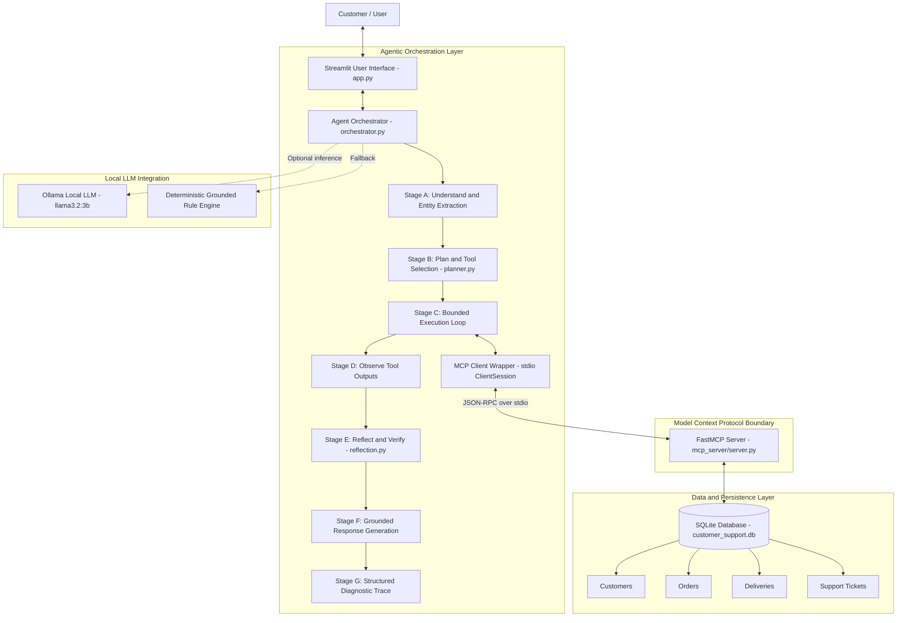

# AI Customer Support Agent Using Agentic AI and MCP

An end-to-end, Level 2 AI Engineering project demonstrating how to build an autonomous, grounded customer support assistant. The system connects an **Agent Orchestrator** to an independent **Model Context Protocol (MCP)** server over stdio transport, performing live database lookups, multi-step planning, reflection/verification, and ticket persistence in SQLite.

---

## Table of Contents
1. [Project Overview & Problem Statement](#1-project-overview--problem-statement)
2. [Key Objectives & Features](#2-key-objectives--features)
3. [System Architecture](#3-system-architecture)
4. [Core Concepts Explained](#4-core-concepts-explained)
   - [What is Model Context Protocol (MCP)?](#what-is-model-context-protocol-mcp)
   - [MCP vs. Direct Python Function Calls](#mcp-vs-direct-python-function-calls)
   - [Tools vs. Resources vs. Prompts](#tools-vs-resources-vs-prompts)
   - [The 7-Stage Agentic Workflow](#the-7-stage-agentic-workflow)
5. [Why SQLite and Streamlit?](#5-why-sqlite-and-streamlit)
6. [Folder Structure](#6-folder-structure)
7. [Prerequisites](#7-prerequisites)
8. [Installation & Setup (Windows PowerShell)](#8-installation--setup-windows-powershell)
9. [Ollama Local LLM Configuration](#9-ollama-local-llm-configuration)
10. [Database Schema & Seed Data](#10-database-schema--seed-data)
11. [Running the Application](#11-running-the-application)
12. [Running Automated Tests & Evaluation](#12-running-automated-tests--evaluation)
13. [Demonstration Scenarios & Example Queries](#13-demonstration-scenarios--example-queries)
14. [Troubleshooting & Common Errors](#14-troubleshooting--common-errors)
15. [Limitations & Future Enhancements](#15-limitations--future-enhancements)

---

## 1. Project Overview & Problem Statement

### The Problem
Traditional e-commerce support systems force customers through rigid telephone trees, confusing self-service portals, or long waiting queues just to answer routine questions:
- *"Where is my package?"*
- *"When will it arrive?"*
- *"Can I return this item?"*
- *"My package arrived damaged; please open a ticket."*

Generic LLM chatbots often attempt to answer these questions by **hallucinating** plausible-sounding order numbers, fake tracking links, or invented policy details. When they do take actions, they lack deterministic verification, resulting in false claims that tickets have been created when no database record was written.

### The Solution
The **AI Customer Support Agent** solves this through a grounded **Agentic Workflow** communicating with a true **Model Context Protocol (MCP)** server:
1. It parses the customer's intent and extracts relevant identifiers (e.g., `ORD1001`, `CUST1003`).
2. It formulates a concrete, bounded plan of action.
3. It discovers and invokes official MCP tools via standard JSON-RPC over `stdio`.
4. It reads actual tool outputs from a persistent SQLite database.
5. It reflects on and verifies the facts before speaking (confirming dates, return policy windows, and database persistence).
6. It synthesizes a concise, grounded response backed by genuine database evidence.

---

## 2. Key Objectives & Features

- **Genuine MCP Implementation:** Utilizes the official Python MCP SDK (`mcp` with `FastMCP`) on the server and `stdio_client` with `ClientSession` on the client.
- **7 MCP Tools:** Covers order details, customer history, delivery tracking, return eligibility computation, return policies, ticket creation, and ticket status lookup.
- **2 MCP Resources:** Exposes official company policy (`support://policies/returns`) and customer FAQ (`support://knowledge/faq`).
- **2 MCP Prompts:** Provides reusable standardized templates (`customer_support_response` and `resolve_customer_issue`).
- **Deterministic Reflection & Verification:** Strictly verifies that orders exist, return eligibility matches policy rules, and support tickets are confirmed in SQLite before informing the customer.
- **Clarification on Ambiguity:** Politely prompts the customer for missing Order or Ticket IDs instead of guessing or executing arbitrary queries.
- **Persistent Storage:** SQLite database seeded with 12 customers, 22 orders, and 3 tickets. New support tickets persist across restarts.
- **Interactive Streamlit Interface:** Features real-time chat, live execution trace inspection, MCP status monitoring, sample scenario buttons, and an embedded database viewer.
- **Comprehensive Evaluation Suite:** 22 benchmark test cases calculating tool selection accuracy, task success rate, grounded verification pass rate, and execution latency.

---

## 3. System Architecture




## 4. Core Concepts Explained

### What is Model Context Protocol (MCP)?
The **Model Context Protocol (MCP)** is an open standard created by Anthropic that standardizes how AI applications provide tools, resources, and prompt templates to LLMs. Rather than writing proprietary, application-specific integrations for every database or API, MCP defines a universal client-server protocol using JSON-RPC.

### MCP vs. Direct Python Function Calls
| Dimension | Direct Python Function Call | Genuine Model Context Protocol (MCP) |
| :--- | :--- | :--- |
| **Coupling** | Tight coupling; agent imports server module directly. | Decoupled; client and server communicate across process boundaries over standard I/O (`stdio`). |
| **Discovery** | Hardcoded function references. | Dynamic discovery; client queries `list_tools()`, `list_resources()`, and `list_prompts()` at runtime. |
| **Security** | Direct access to internal database connection objects and process memory. | Strict boundary; server validates parameters, enforces schemas, and isolates data. |
| **Language Agnostic** | Python only. | Any MCP-compliant client (Python, TypeScript, Go, IDEs like Antigravity) can connect to the server. |

### Tools vs. Resources vs. Prompts
1. **Tools (`@mcp.tool()`):** Executable functions that take arguments, perform computation or database lookups, and return structured output.
   - Example: `check_return_eligibility(order_id="ORD1001")`
2. **Resources (`@mcp.resource()`):** Passive contextual data referenced by URI (like files or static documents) that the agent can read without performing stateful actions.
   - Example: `support://policies/returns`
3. **Prompts (`@mcp.prompt()`):** Standardized, parameterized prompt templates registered on the server to guide LLM reasoning and response formatting.
   - Example: `customer_support_response(query=..., evidence=...)`

### The 7-Stage Agentic Workflow
1. **UNDERSTAND:** Extracts entities (`ORD1001`, `CUST1003`, `TICKET1001`) and classifies intent.
2. **PLAN:** Determines the required MCP tools and sequences them. If an identifier is missing, flags for clarification.
3. **EXECUTE:** Invokes tools via the MCP client over `stdio` in a bounded loop.
4. **OBSERVE:** Captures raw tool responses and handles status flags.
5. **REFLECT / VERIFY:** Cross-references returned facts against policy rules and verifies database operations (e.g. verifying that a new ticket was assigned an ID).
6. **RESPOND:** Formulates an empathetic, concise response strictly grounded in verified facts.
7. **LOG / TRACE:** Emits a comprehensive execution trace showing latency, selected tools, input/output arguments, and verification status.

---

## 5. Why SQLite and Streamlit?

- **SQLite:** A self-contained, serverless, zero-configuration SQL database engine. It provides true relational data modeling (foreign keys, joins, constraints), persistent changes across restarts, and complete protection against SQL injection using parameterized queries (`?` placeholders).
- **Streamlit:** A powerful Python framework for rapidly building data and AI web applications. It allows interactive chat interfaces, expandable state inspection, and real-time database views without requiring complex frontend build tooling.

---

## 6. Folder Structure

```
ai-customer-support-agent/
│
├── app.py                      # Interactive Streamlit Web Interface
├── config.py                   # Centralized configuration & environment loader
├── requirements.txt            # Pinned dependencies (mcp<2, streamlit, etc.)
├── .env.example                # Template for environment settings
├── .gitignore                  # Git ignore rules for virtualenvs, caches, etc.
├── README.md                   # Complete architectural & operational documentation
│
├── agent/                      # Agent Orchestration Package
│   ├── __init__.py
│   ├── orchestrator.py         # 7-stage agent lifecycle coordinator
│   ├── planner.py              # Entity extraction, intent classification & plan builder
│   ├── reflection.py           # Result verification & factual grounding checker
│   ├── mcp_client.py           # Official Python MCP client wrapper (stdio ClientSession)
│   └── llm_client.py           # Ollama client with health check & fallback routing
│
├── mcp_server/                 # MCP Server Package
│   ├── __init__.py
│   ├── server.py               # FastMCP server (7 tools, 2 resources, 2 prompts)
│   ├── database.py             # SQLite access layer with parameterized queries
│   └── seed_data.py            # Fictional seed data (12 customers, 22 orders, 3 tickets)
│
├── evaluation/                 # Evaluation & Benchmarking Package
│   ├── __init__.py
│   ├── test_cases.json         # 22 diverse benchmark test scenarios
│   ├── evaluate_agent.py       # Benchmark runner computing accuracy, success rate, latency
│   └── evaluation_report.md    # Generated evaluation report with metrics table
│
├── tests/                      # Automated Test Suite (pytest)
│   ├── test_database.py        # Database operations & SQL injection defense tests
│   ├── test_mcp_server.py      # MCP server tools, resources, and prompt discovery tests
│   └── test_agent.py           # Agent planner, orchestrator, and scenario tests
│
└── data/                       # Persistent Storage Directory
    ├── .gitkeep
    └── customer_support.db     # Auto-generated SQLite database (persists changes)
```

---

## 7. Prerequisites

1. **Operating System:** Windows 10/11, macOS, or Linux.
2. **Python:** Python 3.10, 3.11, or 3.12 (Python 3.11.9 recommended).
3. **Optional Local LLM:** [Ollama](https://ollama.com/) with model `llama3.2:3b`.
   - *Note: If Ollama is not installed or running, the system automatically uses its built-in deterministic fallback engine, maintaining 100% functionality for all tools and workflows.*

---

## 8. Installation & Setup (Windows PowerShell)

Follow these exact steps in **Windows PowerShell**:

### Step 1: Open the Project Directory
```powershell
cd "c:\Users\BandiPavaniKrishnave\Documents\Level 2"
```

### Step 2: Create and Activate Virtual Environment
```powershell
# Create virtual environment
python -m venv venv

# Activate virtual environment
.\venv\Scripts\Activate.ps1
```
*(If PowerShell displays an execution policy error, run: `Set-ExecutionPolicy -Scope Process -ExecutionPolicy RemoteSigned`)*

### Step 3: Install Dependencies
```powershell
pip install -r requirements.txt
```

### Step 4: Configure Environment Variables
```powershell
Copy-Item .env.example .env
```

---

## 9. Ollama Local LLM Configuration

To run with Ollama:
1. Download and install Ollama from [ollama.com](https://ollama.com/download).
2. Open a terminal and pull the recommended lightweight model:
   ```bash
   ollama pull llama3.2:3b
   ```
3. Start the Ollama background daemon:
   ```bash
   ollama serve
   ```
4. In `.env`, ensure the configuration points to your Ollama endpoint:
   ```env
   OLLAMA_BASE_URL=http://localhost:11434
   OLLAMA_MODEL=llama3.2:3b
   DEMO_MODE=auto
   ```

*(If Ollama is offline, the agent automatically runs in labeled **Deterministic Fallback Mode**, ensuring all tests, evaluations, and tools operate without interruption).*

---

## 10. Database Schema & Seed Data

The database initializes automatically in `data/customer_support.db` on first run.

### Tables
1. **`customers`:** `customer_id` (PK), `name`, `email`, `phone`, `membership_tier`, `created_at`
2. **`orders`:** `order_id` (PK), `customer_id` (FK), `order_date`, `status`, `total_amount`, `item_name`, `category`, `is_final_sale`
3. **`deliveries`:** `delivery_id` (PK), `order_id` (FK), `carrier`, `tracking_number`, `status`, `estimated_delivery_date`, `actual_delivery_date`, `delivery_address`
4. **`support_tickets`:** `ticket_id` (PK), `customer_id` (FK), `order_id` (FK), `issue`, `description`, `status`, `priority`, `created_at`, `updated_at`

### Representative Seed Records
| Order ID | Customer | Item Description | Status | Delivered Date / Est. | Return Eligible? |
| :---: | :---: | :--- | :---: | :---: | :---: |
| `ORD1001` | `CUST1001` | Wireless Noise-Canceling Headphones | Delivered | 2026-10-15 | **Yes** (5 days ago, within 30d) |
| `ORD1002` | `CUST1001` | Winter Thermal Parka | In Transit | Est: 2026-10-23 | **No** (Undelivered) |
| `ORD1003` | `CUST1002` | Espresso Coffee Machine | Delivered | 2026-09-05 | **No** (45 days ago, expired window) |
| `ORD1004` | `CUST1003` | Ergonomic Mechanical Keyboard | Delivered | 2026-10-18 | **Yes** (Ready for damaged ticket) |
| `ORD1005` | `CUST1004` | AI Engineering: Principles & Systems | Processing | Est: 2026-10-25 | **No** (Undelivered) |
| `ORD1006` | `CUST1005` | Non-Slip Yoga Mat & Blocks | Cancelled | None | **No** (Cancelled order) |
| `ORD1007` | `CUST1006` | Clearance Running Shoes (Final Sale) | Delivered | 2026-10-10 | **No** (Final Sale restriction) |

---

## 11. Running the Application

Launch the Streamlit web application:
```powershell
streamlit run app.py
```
Open your browser to the URL displayed in the terminal:
👉 **`http://localhost:8501`**

---

## 12. Running Automated Tests & Evaluation

### Run Automated Unit & Integration Tests (pytest)
```powershell
pytest -v
```
*Expected Result:* 28 passed in ~90 seconds across database, MCP server, tools, reflection, and scenarios.

### Run Benchmark Evaluation (22 Scenarios)
```powershell
python evaluation/evaluate_agent.py
```
*Expected Result:*
```
=================================================================
                     EVALUATION RESULTS
=================================================================
Total Test Cases Evaluated:       22
Tool Selection Accuracy:          100.0% (22/22)
Task Success Rate:                100.0% (22/22)
Grounded Response Pass Rate:      100.0% (22/22)
Average Response Latency:         ~6900 ms
Unexpected Tool Failures:         0
=================================================================
```
Full markdown metrics are automatically written to `evaluation/evaluation_report.md`.

---

## 13. Demonstration Scenarios & Example Queries

### Scenario 1: Order Tracking
- **Query:** `Where is order ORD1001?`
- **MCP Tools Called:** `get_order`, `check_delivery_status`
- **Grounding:** Confirms order is `Delivered` via FedEx (Tracking: `FDX-99881122`).

### Scenario 2: Delivery Follow-Up
- **Query:** `My order ORD1002 has not arrived. When will it be delivered?`
- **MCP Tools Called:** `get_order`, `check_delivery_status`
- **Grounding:** Reports order is `In Transit` via UPS with expected delivery date `2026-10-23`.

### Scenario 3: Return Eligibility Check (Expired)
- **Query:** `Can I return order ORD1003?`
- **MCP Tools Called:** `get_order`, `check_return_eligibility`
- **Grounding:** Ineligible because delivered 45 days ago, exceeding the 30-day policy limit.

### Scenario 4: Damaged Item & Ticket Creation
- **Query:** `My order ORD1004 arrived damaged. Please create a support ticket.`
- **MCP Tools Called:** `get_order`, `create_support_ticket`
- **Grounding:** Verifies order, dynamically binds customer `CUST1003`, inserts new ticket into SQLite, and returns verified ID (e.g., `TICKET1004`).

### Scenario 5: Check Existing Ticket
- **Query:** `What is the status of ticket TICKET1001?`
- **MCP Tools Called:** `get_support_ticket`
- **Grounding:** Confirms ticket `TICKET1001` exists with status `RESOLVED`.

### Scenario 6: Unknown Order Handling
- **Query:** `Where is order ORD9999?`
- **MCP Tools Called:** `get_order`
- **Grounding:** Correctly detects `ORD9999` does not exist; never invents fake dates or tracking numbers.

### Scenario 7: Ambiguous Request Clarification
- **Query:** `I need help with my order.`
- **MCP Tools Called:** None (short-circuits before executing unnecessary queries)
- **Clarification:** Politely requests the customer's Order ID (e.g. `ORD1001`).

### Scenario 8: Return Policy FAQ
- **Query:** `What is your return policy?`
- **MCP Resource Read:** `support://policies/returns`
- **Grounding:** Explains 30-day window, original condition requirements, and final sale exclusions.

### Scenario 9: Multi-Step Request
- **Query:** `Check order ORD1001, tell me its delivery status, and check whether it can be returned.`
- **MCP Tools Called:** `get_order`, `check_delivery_status`, `check_return_eligibility`
- **Grounding:** Consolidates delivery date and return eligibility into a single structured response.

---

## 14. Troubleshooting & Common Errors

1. **`ModuleNotFoundError: No module named 'mcp.server.fastmcp'`**
   - *Cause:* Installing `mcp>=2.0.0` where FastMCP was renamed.
   - *Fix:* Ensure `mcp>=1.2.0,<2.0.0` is installed (pinned in `requirements.txt`).
2. **`Connection refused to http://localhost:11434`**
   - *Cause:* Ollama daemon is not running.
   - *Fix:* Start `ollama serve` or leave `DEMO_MODE=auto` to use the automatic deterministic fallback engine.
3. **PowerShell Script Execution Error (`Activate.ps1 cannot be loaded`)**
   - *Fix:* Execute `Set-ExecutionPolicy -Scope Process -ExecutionPolicy RemoteSigned` in your PowerShell session.
4. **`database is locked`**
   - *Cause:* Concurrently modifying the SQLite file.
   - *Fix:* Database helper uses scoped context managers that close transactions immediately.

---

## 15. Limitations & Future Enhancements

- **Single-Agent Scope:** The current version uses a bounded orchestrator. A Level 3 extension could add specialized multi-agent subagents (e.g. `LogisticsAgent`, `ReturnsAgent`, `EscalationsAgent`).
- **Authentication:** In a production system, customer session identity would be derived from JWT/OAuth tokens rather than query text.
- **Human-in-the-Loop:** Future iterations can add Streamlit interactive approval dialogs before writing irreversible database actions.
