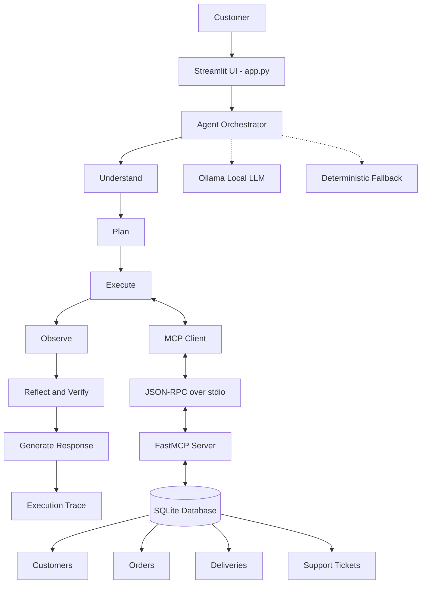

# AI Customer Support Agent Using Agentic AI and MCP

An end-to-end, AI Engineering project demonstrating how to build an autonomous, grounded customer support assistant.

The system connects an Agent Orchestrator to an independent Model Context Protocol (MCP) server over stdio transport. It performs live database lookups, multi-step planning, reflection and verification, and persistent support-ticket creation using SQLite.

The project demonstrates how Agentic AI, MCP, local LLM integration, and deterministic execution can work together to build a reliable customer support system.

---

# Table of Contents

1. [Project Overview & Problem Statement](#1-project-overview--problem-statement)
2. [Key Objectives & Features](#2-key-objectives--features)
3. [System Architecture](#3-system-architecture)
4. [Core Concepts Explained](#4-core-concepts-explained)
5. [Why SQLite and Streamlit?](#5-why-sqlite-and-streamlit)
6. [Folder Structure](#6-folder-structure)
7. [Prerequisites](#7-prerequisites)
8. [Installation & Setup](#8-installation--setup-windows-powershell)
9. [Ollama Local LLM Configuration](#9-ollama-local-llm-configuration)
10. [Database Schema & Seed Data](#10-database-schema--seed-data)
11. [Running the Application](#11-running-the-application)
12. [Running Automated Tests & Evaluation](#12-running-automated-tests--evaluation)
13. [Demonstration Scenarios & Example Queries](#13-demonstration-scenarios--example-queries)
14. [Troubleshooting & Common Errors](#14-troubleshooting--common-errors)
15. [Limitations & Future Enhancements](#15-limitations--future-enhancements)

---

# 1. Project Overview & Problem Statement

## The Problem

Traditional e-commerce support systems often force customers through rigid telephone menus, confusing self-service portals, or long waiting queues just to answer routine questions:

- Where is my package?
- When will it arrive?
- Can I return this item?
- My package arrived damaged. Can you create a support ticket?

Generic LLM chatbots can generate plausible-sounding but incorrect responses, including invented order details, tracking information, and policy explanations.

When these systems perform actions, they may also claim that an operation succeeded without verifying whether the corresponding database operation actually took place.

## The Solution

The AI Customer Support Agent addresses these problems through a grounded Agentic AI workflow connected to a genuine Model Context Protocol (MCP) server.

The system:

1. Understands the customer's request and identifies relevant entities, such as order IDs and customer IDs.
2. Creates a structured, bounded execution plan.
3. Discovers and invokes MCP tools through standard JSON-RPC communication over stdio.
4. Retrieves actual information from a persistent SQLite database.
5. Observes tool outputs and checks their results.
6. Reflects on and verifies the retrieved information before responding.
7. Generates a concise response grounded in verified database evidence.

The agent avoids guessing missing identifiers and asks customers for clarification when necessary.

---

# 2. Key Objectives & Features

## Genuine MCP Implementation

Uses the official Python MCP SDK:

- FastMCP for the MCP server.
- `stdio_client` for client-server communication.
- `ClientSession` for managing the MCP session.
- Runtime discovery of tools, resources, and prompts.

The MCP server runs as an independent process and communicates with the agent through stdio transport.

## MCP Tools

The server exposes seven tools:

| Tool | Purpose |
|---|---|
| `get_order(order_id)` | Retrieves order details |
| `get_customer_orders(customer_id)` | Retrieves a customer's order history |
| `check_delivery_status(order_id)` | Checks delivery and tracking information |
| `check_return_eligibility(order_id)` | Evaluates whether an order meets return conditions |
| `get_return_policy()` | Retrieves return policy information |
| `create_support_ticket(customer_id, order_id, issue, description)` | Creates a support ticket |
| `get_support_ticket(ticket_id)` | Retrieves an existing support ticket |

## MCP Resources

The server exposes two resources:

| Resource URI | Purpose |
|---|---|
| `support://policies/returns` | Official return policy information |
| `support://knowledge/faq` | Customer support FAQ information |

## MCP Prompts

Two reusable prompt templates are provided:

- `customer_support_response`
- `resolve_customer_issue`

These templates provide standardized guidance for customer support responses and issue resolution.

## Deterministic Reflection and Verification

The agent verifies important results before responding.

Examples include:

- Checking whether an order actually exists.
- Confirming delivery information using tool outputs.
- Validating return eligibility against the policy rules.
- Confirming that a support ticket was successfully created and persisted.
- Avoiding unsupported claims when information is unavailable.

## Clarification and Ambiguity Handling

The agent requests missing identifiers instead of guessing.

For example:

Customer: "I need help with my order."

Agent: "Could you please provide your Order ID so I can look up the correct order?"

## Persistent Storage

SQLite provides persistent storage for:

- 12 fictional customers.
- 22 fictional orders.
- 3 initial support tickets.

Newly created support tickets are stored in the database and persist across application restarts.

## Interactive Streamlit Interface

The application provides:

- Interactive customer support chat.
- Sample customer queries.
- Agent execution trace inspection.
- MCP connection status monitoring.
- LLM status information.
- Database inspection interface.

## Evaluation Suite

The evaluation package includes 22 benchmark scenarios covering different customer support workflows.

It measures:

- Tool Selection Accuracy.
- Task Success Rate.
- Grounded Response Pass Rate.
- Average Response Latency.
- Unexpected Tool Failures.

---
## 3. System Architecture



## 4. Core Concepts Explained

## What is Model Context Protocol (MCP)?

Model Context Protocol (MCP) is an open standard originally introduced by Anthropic that standardizes how AI applications connect to external tools, resources, and prompt templates.

Instead of creating a separate custom integration for every application or data source, MCP provides a standardized client-server communication protocol based on JSON-RPC.

In this project, MCP separates the Agent Orchestrator from the database operations handled by the independent MCP server.

## MCP vs. Direct Python Function Calls

| Dimension | Direct Python Function Call | Model Context Protocol |
|---|---|---|
| Coupling | Agent directly imports server functions | Client and server communicate through a protocol boundary |
| Discovery | Function references are generally hardcoded | Client can discover tools, resources, and prompts at runtime |
| Communication | Direct function invocation | JSON-RPC over stdio |
| Separation | Components may share the same process | Independent client and server processes |
| Language support | Depends on the Python implementation | Supports different MCP-compatible clients and servers |

## Tools vs. Resources vs. Prompts

MCP provides different ways to expose capabilities and information.

**Tools (`@mcp.tool()`)**

Executable operations that accept arguments and perform actions such as database lookups or ticket creation.

Example:

`check_return_eligibility(order_id="ORD1001")`

**Resources (`@mcp.resource()`)**

Read-only contextual information exposed through resource URIs.

Example:

`support://policies/returns`

**Prompts (`@mcp.prompt()`)**

Reusable prompt templates that provide standardized instructions or response structures.

Example:

`customer_support_response(query=..., evidence=...)`

## The 7-Stage Agentic Workflow

The application follows a structured seven-stage workflow.

### Stage A: Understand

- Receives the customer's natural-language query.
- Identifies the intent.
- Extracts relevant entities such as ORD1001, CUST1003, and TICKET1001.
- Identifies missing information.

### Stage B: Plan

- Determines the required MCP tools.
- Creates an execution sequence.
- Handles ambiguous requests.
- Prevents unnecessary tool execution.

### Stage C: Execute

- Invokes the selected tools through the MCP client.
- Communicates with the independent MCP server over stdio.
- Uses a bounded execution loop.

### Stage D: Observe

- Captures MCP tool responses.
- Inspects returned data and status information.
- Handles missing or unsuccessful results.

### Stage E: Reflect and Verify

- Checks whether the returned information supports the requested answer.
- Validates relevant policy conditions.
- Verifies database operations before claiming success.

### Stage F: Respond

- Generates a concise and understandable response.
- Uses verified database information.
- Avoids unsupported claims and invented details.

### Stage G: Log and Trace

- Records the execution workflow.
- Displays selected tools and execution details.
- Tracks latency and verification information.
- Helps inspect the agent's decisions and behavior.

---

# 5. Why SQLite and Streamlit?

## SQLite

SQLite is a lightweight, serverless relational database engine.

It is suitable for this project because it provides:

- Persistent data storage.
- Relational tables and foreign-key relationships.
- SQL queries and constraints.
- Transaction support.
- No separate database server installation.
- Parameterized queries for safer database operations.

The project uses SQLite to store customer records, order information, delivery information, and support tickets.

## Streamlit

Streamlit is a Python framework for building interactive data and AI applications.

It is used to provide:

- A conversational customer support interface.
- Interactive sample queries.
- Expandable execution traces.
- MCP and LLM status information.
- Database inspection.

Streamlit allows the project to have a functional web interface without requiring a separate frontend framework.

---

# 6. Folder Structure

```text
AI-Customer-Support-Agent/
│
├── app.py
├── config.py
├── requirements.txt
├── .env.example
├── .gitignore
├── README.md
│
├── agent/
│   ├── __init__.py
│   ├── orchestrator.py
│   ├── planner.py
│   ├── reflection.py
│   ├── mcp_client.py
│   └── llm_client.py
│
├── mcp_server/
│   ├── __init__.py
│   ├── server.py
│   ├── database.py
│   └── seed_data.py
│
├── evaluation/
│   ├── __init__.py
│   ├── test_cases.json
│   ├── evaluate_agent.py
│   └── evaluation_report.md
│
├── tests/
│   ├── test_agent.py
│   ├── test_conversational_memory.py
│   ├── test_database.py
│   └── test_mcp_server.py
│
└── data/
    └── .gitkeep
```

## Important Files

| File | Responsibility |
|---|---|
| `app.py` | Streamlit user interface |
| `config.py` | Centralized application configuration |
| `agent/orchestrator.py` | Agent lifecycle coordination |
| `agent/planner.py` | Intent classification, entity extraction, and planning |
| `agent/reflection.py` | Result verification and grounding |
| `agent/mcp_client.py` | MCP client communication |
| `agent/llm_client.py` | Ollama integration and fallback routing |
| `mcp_server/server.py` | FastMCP server implementation |
| `mcp_server/database.py` | SQLite database operations |
| `mcp_server/seed_data.py` | Fictional seed data |
| `evaluation/evaluate_agent.py` | Benchmark evaluation runner |
| `evaluation/test_cases.json` | Benchmark scenarios |
| `evaluation/evaluation_report.md` | Evaluation results |
| `tests/` | Automated test suite |

The SQLite database is initialized automatically when required and is stored locally in the `data/` directory.

---

# 7. Prerequisites

Before running the project, install the following:

| Requirement | Version / Details |
|---|---|
| Operating System | Windows 10/11, macOS, or Linux |
| Python | 3.10, 3.11, or 3.12 |
| pip | Python package installer |
| Git | Required for cloning the repository |
| Ollama | Optional |
| LLM Model | `llama3.2:3b` (optional) |

Python 3.11.9 is recommended.

**Note:** Ollama is optional. If the local LLM is unavailable, the application can use its deterministic fallback engine for supported workflows.

---

# 8. Installation & Setup (Windows PowerShell)

Follow these steps to run the project locally.

## Step 1: Clone the GitHub Repository

```powershell
git clone https://github.com/Pavanibandi19/AI-Customer-Support-Agent.git
```

## Step 2: Navigate to the Project Directory

```powershell
cd AI-Customer-Support-Agent
```

## Step 3: Create a Virtual Environment

```powershell
python -m venv venv
```

## Step 4: Activate the Virtual Environment

```powershell
.\venv\Scripts\Activate.ps1
```

If PowerShell displays an execution policy error, run:

```powershell
Set-ExecutionPolicy -Scope Process -ExecutionPolicy RemoteSigned
```

Then activate the environment again:

```powershell
.\venv\Scripts\Activate.ps1
```

## Step 5: Install Dependencies

```powershell
pip install -r requirements.txt
```

## Step 6: Configure Environment Variables

Create a local `.env` file from the example:

```powershell
Copy-Item .env.example .env
```

Review the environment variables and adjust them if necessary.

Do not commit your actual `.env` file or credentials to GitHub.

---

# 9. Ollama Local LLM Configuration

The project supports optional local LLM inference through Ollama.

## Step 1: Install Ollama

Download Ollama from:

https://ollama.com/

## Step 2: Download the Model

Open a terminal and run:

```powershell
ollama pull llama3.2:3b
```

## Step 3: Start the Ollama Service

```powershell
ollama serve
```

If Ollama is already running as a background service, you do not need to start another instance.

## Step 4: Configure the Environment

In your `.env` file, configure:

```env
OLLAMA_BASE_URL=http://localhost:11434
OLLAMA_MODEL=llama3.2:3b
DEMO_MODE=auto
```

Use the exact variable names provided in `.env.example`.

## Fallback Behavior

When Ollama is unavailable, the application can use its deterministic fallback engine.

This allows supported customer support workflows to operate without requiring a running local LLM.

The fallback mode should not be confused with LLM-generated responses; it uses the application's deterministic logic.

---

# 10. Database Schema & Seed Data

The project uses SQLite for persistent storage.

The database is initialized automatically when required.

Default database location:

`data/customer_support.db`

## Database Tables

### 1. Customers

Stores customer information.

| Column | Description |
|---|---|
| customer_id | Primary key |
| name | Customer name |
| email | Customer email |
| phone | Customer phone |
| membership_tier | Membership category |
| created_at | Account creation timestamp |

### 2. Orders

Stores customer order information.

| Column | Description |
|---|---|
| order_id | Primary key |
| customer_id | Customer reference |
| order_date | Order date |
| status | Order status |
| total_amount | Order amount |
| item_name | Purchased item |
| category | Product category |
| is_final_sale | Final-sale indicator |

### 3. Deliveries

Stores delivery and tracking information.

| Column | Description |
|---|---|
| delivery_id | Primary key |
| order_id | Order reference |
| carrier | Delivery carrier |
| tracking_number | Tracking identifier |
| status | Delivery status |
| estimated_delivery_date | Estimated delivery date |
| actual_delivery_date | Actual delivery date |
| delivery_address | Delivery address |

### 4. Support Tickets

Stores customer support tickets.

| Column | Description |
|---|---|
| ticket_id | Primary key |
| customer_id | Customer reference |
| order_id | Related order |
| issue | Issue category |
| description | Issue description |
| status | Ticket status |
| priority | Ticket priority |
| created_at | Creation timestamp |
| updated_at | Last update timestamp |

## Seed Data

The initial database contains fictional demonstration data:

- 12 customers.
- 22 orders.
- 3 support tickets.

The seed data is used to demonstrate order tracking, return eligibility, customer history, and support ticket workflows.

**Note:** These are static demonstration records. Their dates and statuses represent the seeded dataset and should not be interpreted as live delivery information.

---

# 11. Running the Application

After completing installation and configuration, activate your virtual environment and navigate to the project directory.

Run:

```powershell
streamlit run app.py
```

Streamlit will start the local web server.

Open the URL displayed in the terminal:

http://localhost:8501

## Application Features

The Streamlit application provides:

- Customer support chat.
- Sample queries for testing different workflows.
- Agent execution traces.
- MCP server status.
- LLM availability information.
- Database inspection.

The application can be stopped using `Ctrl + C` in the terminal.

---

# 12. Running Automated Tests & Evaluation

The project includes automated tests and a separate evaluation benchmark.

## A. Run Automated Tests

Execute:

```powershell
python -m pytest -v
```

This runs the automated test suite covering:

- Database operations.
- MCP server functionality.
- Tool discovery and execution.
- Agent planning.
- Orchestration.
- Conversational memory.
- Customer support workflows.

### Previously Recorded Test Results

The full test suite previously completed with:

```text
50 passed
```

The full run took approximately 14 minutes.

After the latest refund-query changes, the focused regression test completed with:

```text
1 passed, 22 deselected
```

The full test suite should be rerun after the latest changes before treating the 50-test result as the final submission result.

## B. Run Benchmark Evaluation

Execute:

```powershell
python evaluation/evaluate_agent.py
```

The evaluation runner executes the 22 benchmark scenarios defined in:

`evaluation/test_cases.json`

It measures the following:

| Metric | Description |
|---|---|
| Tool Selection Accuracy | Whether the appropriate tools were selected |
| Task Success Rate | Whether the requested task was completed |
| Grounded Response Pass Rate | Whether responses were supported by verified information |
| Average Response Latency | Average end-to-end response time |
| Unexpected Tool Failures | Unexpected failures during tool execution |

### Previously Recorded Evaluation Results

The previously completed benchmark reported:

```text
=============================================================
                     EVALUATION RESULTS
=============================================================
Total Test Cases Evaluated:       22
Tool Selection Accuracy:          100.0% (22/22)
Task Success Rate:                100.0% (22/22)
Grounded Response Pass Rate:      100.0% (22/22)
Average Response Latency:         6170.90 ms
Unexpected Tool Failures:         0
=============================================================
```

These results were recorded before the latest refund-query modifications. Rerun the evaluation to establish the final results for the current code.

The evaluation runner writes its results to:

`evaluation/evaluation_report.md`

---

# 13. Demonstration Scenarios & Example Queries

The following scenarios demonstrate the different capabilities of the customer support agent.

## Scenario 1: Order Tracking

**Query:**

"Where is order ORD1001?"

**Expected workflow:**

- Retrieve the order.
- Check delivery status.
- Return the available carrier and tracking information.

**MCP Tools:**

- `get_order`
- `check_delivery_status`

**Grounding:**

The response should be based on the actual seeded order and delivery records, not invented tracking information.

## Scenario 2: Delivery Follow-Up

**Query:**

"My order ORD1002 has not arrived. When will it be delivered?"

**Expected workflow:**

- Retrieve order information.
- Check delivery details.
- Report the available delivery status and estimated date.

**MCP Tools:**

- `get_order`
- `check_delivery_status`

## Scenario 3: Return Eligibility Check

**Query:**

"Can I return order ORD1003?"

**Expected workflow:**

- Retrieve order information.
- Check return eligibility.
- Explain the result using the return policy.

**MCP Tools:**

- `get_order`
- `check_return_eligibility`

## Scenario 4: Damaged Item and Ticket Creation

**Query:**

"My order ORD1004 arrived damaged. Please create a support ticket."

**Expected workflow:**

1. Retrieve the order.
2. Identify the associated customer.
3. Create a support ticket.
4. Verify that the ticket was successfully persisted.
5. Return the confirmed ticket ID.

**MCP Tools:**

- `get_order`
- `create_support_ticket`

## Scenario 5: Check Existing Ticket

**Query:**

"What is the status of ticket TICKET1001?"

**Expected workflow:**

- Retrieve the ticket from the database.
- Report its actual status.

**MCP Tool:**

- `get_support_ticket`

## Scenario 6: Unknown Order Handling

**Query:**

"Where is order ORD9999?"

**Expected workflow:**

- Attempt to retrieve the specified order.
- Detect that the order does not exist.
- Inform the customer that the order could not be found.

**MCP Tool:**

- `get_order`

The agent should not invent delivery dates, carriers, or tracking numbers.

## Scenario 7: Ambiguous Request Clarification

**Query:**

"I need help with my order."

**Expected workflow:**

- Identify that the request is ambiguous.
- Avoid selecting an unrelated historical order.
- Ask the customer for the required Order ID.

No unnecessary MCP database lookup should be performed.

## Scenario 8: Return Policy FAQ

**Query:**

"What is your return policy?"

**Expected workflow:**

- Read the return policy resource.
- Explain the relevant conditions, eligibility window, and exclusions.

**MCP Resource:**

`support://policies/returns`

## Scenario 9: Multi-Step Request

**Query:**

"Check order ORD1001, tell me its delivery status, and check whether it can be returned."

**Expected workflow:**

- Retrieve the order.
- Check delivery status.
- Check return eligibility.
- Combine the verified results into one response.

**MCP Tools:**

- `get_order`
- `check_delivery_status`
- `check_return_eligibility`

## Additional Query Testing

The project can also be tested with:

- "Show all my orders for customer CUST1001."
- "When will I receive my refund?"
- "What condition should an item be in for a return?"
- "Can you create a support ticket for my damaged order?"
- "Show the status of ticket TICKET1001."
- "My order was delivered by DHL. Is that correct?"

These queries help evaluate customer history retrieval, policy understanding, refund information, ticket persistence, and resistance to incorrect user-provided assumptions.

---

# 14. Troubleshooting & Common Errors

## Error 1: ModuleNotFoundError

Example:

`No module named 'mcp.server.fastmcp'`

**Possible cause:**

An incompatible MCP package version is installed.

**Solution:**

The project uses the MCP SDK version range specified in `requirements.txt`.

Reinstall dependencies:

```powershell
pip install -r requirements.txt
```

The project expects the compatible MCP SDK API used by its FastMCP implementation.

## Error 2: Ollama Connection Refused

Example:

`Connection refused to http://localhost:11434`

**Cause:**

Ollama is not running or the configured endpoint is unavailable.

**Solution:**

Start Ollama:

```powershell
ollama serve
```

Alternatively, use the configured deterministic fallback mode.

## Error 3: PowerShell Script Execution Error

Example:

`Activate.ps1 cannot be loaded because running scripts is disabled`

**Solution:**

Run:

```powershell
Set-ExecutionPolicy -Scope Process -ExecutionPolicy RemoteSigned
```

Then activate the virtual environment again.

## Error 4: SQLite Database Locked

**Possible cause:**

Concurrent database operations or an unclosed transaction.

**Solution:**

The database layer uses scoped database connections and transaction handling. If the issue persists, stop duplicate application processes and restart the application.

## Error 5: Streamlit Application Does Not Start

**Possible causes:**

- Virtual environment is not activated.
- Dependencies are missing.
- Incorrect project directory.
- Port 8501 is already in use.

**Solution:**

Verify the active environment and reinstall dependencies if required.

Run:

```powershell
streamlit run app.py
```

---

# 15. Limitations & Future Enhancements

Although the current implementation demonstrates a functional Agentic AI customer support workflow, several improvements can be explored in future versions.

## 1. Single-Agent Architecture

The current system uses one bounded Agent Orchestrator.

A future Level 3 extension could introduce specialized agents such as:

- Logistics Agent.
- Returns Agent.
- Customer History Agent.
- Escalation Agent.

These agents could collaborate on more complex customer requests.

## 2. Authentication and Authorization

The current project uses fictional demonstration customer data.

A production implementation should authenticate users and derive customer identity from secure session information, such as JWT or OAuth-based authentication, rather than trusting identifiers supplied in natural-language queries.

## 3. Human-in-the-Loop Approval

Future versions could include interactive approval workflows before performing sensitive or irreversible operations.

For example, a customer support ticket or refund action could require an approval step.

## 4. External API Integrations

The current system uses a local SQLite database and fictional demonstration records.

Future improvements could integrate:

- Real order management systems.
- External delivery tracking APIs.
- Payment and refund services.
- Customer relationship management systems.

## 5. Advanced Evaluation

Future versions could expand the benchmark suite with:

- More complex multi-step conversations.
- Additional ambiguity and adversarial test cases.
- Larger datasets.
- Tool execution reliability measurements.
- Response quality and latency comparisons across LLMs.

---

# Conclusion

The AI Customer Support Agent demonstrates how Agentic AI and the Model Context Protocol can be combined to build a grounded, modular, and verifiable customer support application.

By separating the Agent Orchestrator from the MCP server, the project demonstrates standardized tool discovery and execution, independent server communication, database-backed information retrieval, bounded planning, reflection, and verification.

The integration of SQLite, Streamlit, FastMCP, and optional local LLM inference provides a practical foundation for understanding and implementing agent-based AI engineering systems.

**Technologies Used:**

Python | Agentic AI | Model Context Protocol (MCP) | FastMCP | JSON-RPC | SQLite | Streamlit | Ollama | pytest

---

**Repository:** https://github.com/Pavanibandi19/AI-Customer-Support-Agent

